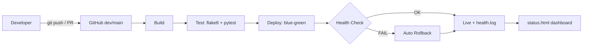

# DevOps Midterm Project

## 1. პროექტის აღწერა
<!-- შეავსე: რა პროექტია, რას აკეთებს -->
მცირე Flask ვებ-აპლიკაცია, რომელსაც აქვს `/health`, `/api/add` და `/api/palindrome` endpoint-ები.
პროექტზე აწყობილია სრული DevOps ჯაჭვი.

**ინსტრუმენტები:** Python 3.12, Flask, pytest, flake8, Git/GitHub, GitHub Actions, Bash (deploy/health check), curl.

## 2. სტრუქტურა
```
app/            აპლიკაციის კოდი (logic.py, main.py)
tests/          unit ტესტები (pytest)
scripts/        deploy.sh, rollback.sh, health_check.sh, generate_status.py
.github/workflows/ci-cd.yml   CI/CD პაიპლაინი
logs/           health.log, deploy.log
```

## 3. ადგილობრივად გაშვება
```bash
python -m venv .venv
.venv\Scripts\activate        # Windows (Linux/Mac: source .venv/bin/activate)
pip install -r requirements.txt
python run.py                 # http://localhost:5000
pytest -v                     # ტესტები
```

## 4. CI/CD პროცესი
პაიპლაინი ავტომატურად იშვება ყოველ `push`-სა და `Pull Request`-ზე (`main`, `dev`).

1. **Build** - Python-ის გარემოს მომზადება, dependencies-ის დაყენება, აპლიკაციის import-ის შემოწმება.
2. **Test** - flake8 კოდის სტილის შემოწმება და pytest unit ტესტები.
3. **Deploy** - (მხოლოდ push-ზე) `scripts/deploy.sh`: ახალი ვერსია იქმნება `production/releases/<დრო>` საქაღალდეში, `current` სიმბოლური ბმული გადაერთვება მასზე (Blue-Green), გაეშვება health check. თუ შემოწმება ვერ გაივლის, ხდება **ავტომატური Rollback** წინა ვერსიაზე.

### Workflow დიაგრამა


## 5. დეპლოიმენტი და მონიტორინგი
- გზა ა (ლოკალური): Blue-Green საქაღალდეები `production/releases`, ბმული `production/current`, Rollback `scripts/rollback.sh` და ავტომატურად health check-ის წარუმატებლობისას.
- Health check: `scripts/health_check.sh` - curl-ით ამოწმებს `/health`-ს და წერს `logs/health.log`-ში.
- ბონუსი: `scripts/generate_status.py` აგენერირებს `status.html` დეშბორდს; Rollback ავტომატიზებულია.

## 6. სქრინშოტები
### წარმატებული 3-საფეხურიანი GitHub Actions პაიპლაინი

<!-- კომენტარი: Build -> Test -> Deploy ყველა მწვანეა -->

### წარმატებული unit ტესტები

<!-- კომენტარი: pytest -v შედეგი -->

### მომუშავე აპლიკაცია

<!-- კომენტარი: http://localhost:5000 ბრაუზერში -->

### Health check ლოგი / დეშბორდი (ბონუსი)

